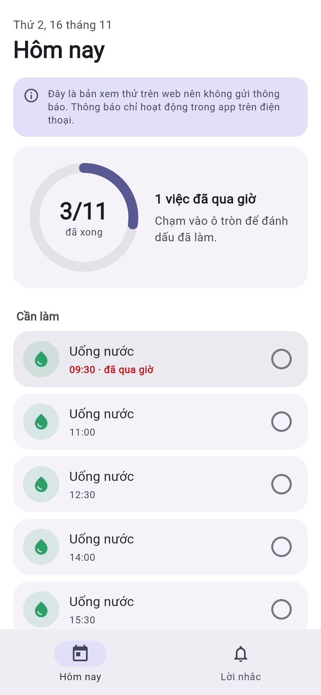
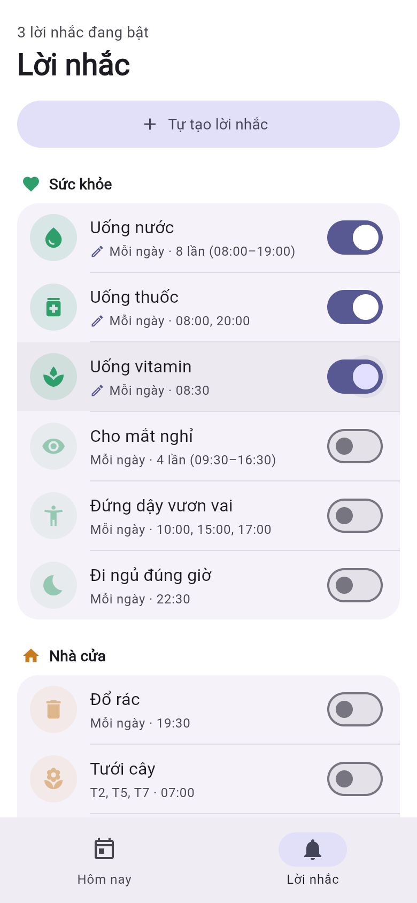
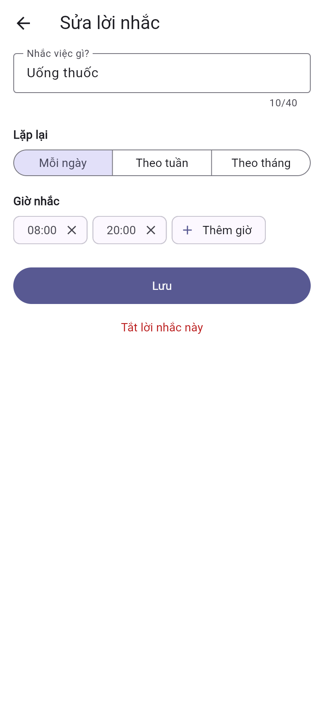
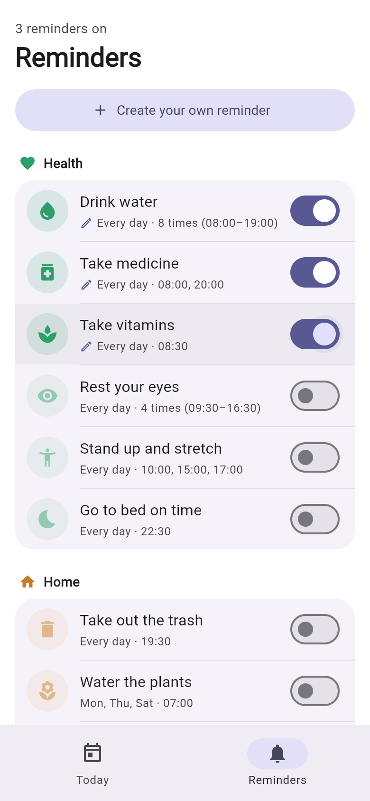
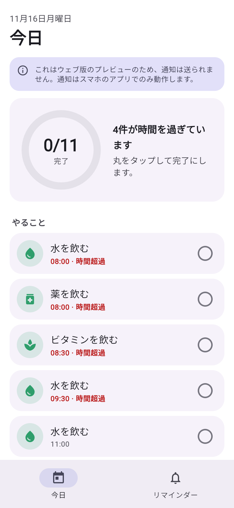
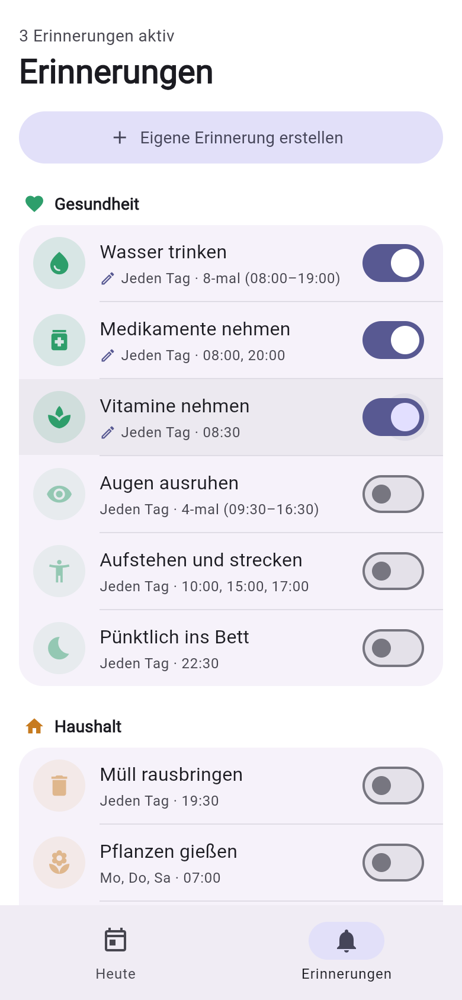

# Nhớ Nhé

App nhắc việc cho người hay quên, chạy trên Android và iPhone (Flutter).
Chọn lời nhắc có sẵn, gạt công tắc là chạy; bấm "Xong" ngay trên thông báo.

| Hôm nay | Thư viện lời nhắc | Sửa lời nhắc |
|---|---|---|
|  |  |  |

**Xem thử trên web:** https://vanphenguyen.github.io/MemoMate/ (chỉ xem giao diện; thông báo chỉ chạy trong app trên điện thoại).

## Có gì trong bản đầu

- 20 lời nhắc có sẵn trong 5 nhóm: Sức khỏe, Nhà cửa, Tiền bạc, Người thân, Ra khỏi nhà.
- Tự tạo lời nhắc riêng, lặp theo ngày, tuần hoặc tháng.
- Màn hình "Hôm nay" với vòng tiến độ.
- Thông báo có nút "Xong" và "Nhắc lại sau 15 phút".
- 10 ngôn ngữ, tự theo ngôn ngữ của điện thoại.
- Không tài khoản, không cần mạng, dữ liệu chỉ nằm trên máy.

| English | 日本語 | Deutsch |
|---|---|---|
|  |  |  |

## Chạy thử

```bash
flutter pub get
```

```bash
flutter run
```

Kiểm tra trước khi commit:

```bash
flutter analyze && flutter test
```

Mỗi lần đẩy code lên GitHub, GitHub Actions build file APK để cài thử trên điện thoại Android
(tab Actions, mục Artifacts, tên `nho-nhe-apk`).

Thiết kế, định dạng dữ liệu và các giới hạn đã biết: xem [docs/THIET_KE.md](docs/THIET_KE.md).
